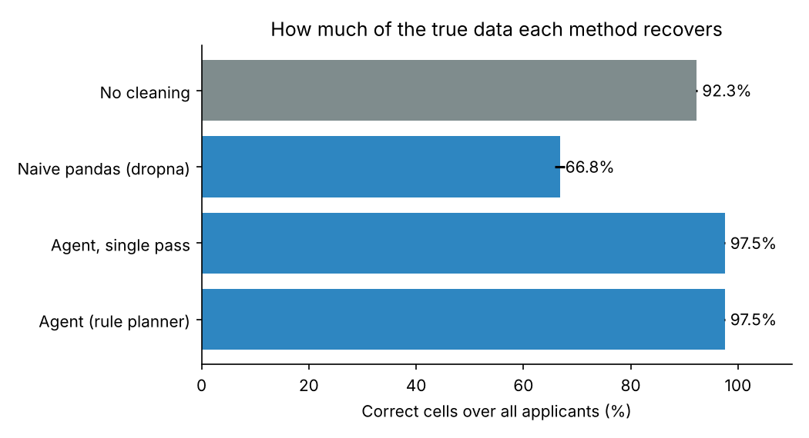
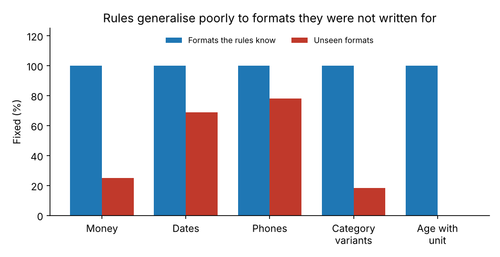
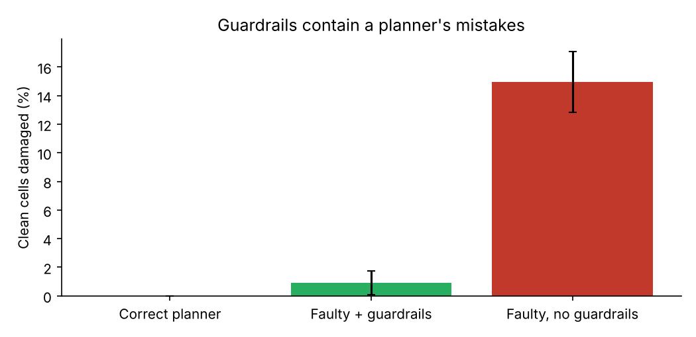

# CleanAgent: an AI agent for cleaning messy Indian data

Real Indian datasets are messy in specific ways: `₹1,20,000`, `1.2 lakh` and `120k` in one column, `05/03/2024`
meaning 5 March, `Bangalore` next to `Bengaluru`, `\xc2\xa0` junk left by bad exports, areas like `1133 - 1384` or
`34.46Sq. Meter`, and `NA`, `-` or `undisclosed` standing in for blanks. CleanAgent finds and fixes these with an
**observe → plan → act → verify** loop, logs every change it makes, and refuses steps that would destroy data.

Idea **#96 (AI agent for data cleaning)** from *100 Innovation Project Ideas* (Dr. M. M. Kazi), Advanced level.
Evaluated on **synthetic data with known truth** and on **three real Indian datasets**, one of them a blind hold-out.

## Runs on a normal laptop

Built and timed for the presentation machine: Intel i3-1005G1, 8 GB RAM, Intel UHD graphics, Windows 11.
No GPU, no internet and no paid API needed.

| Task | Time here | Expected on the i3 |
|---|---|---|
| Clean the startup file (3,044 rows) | 3 s | ~5-10 s |
| Clean the house file (13,320 rows) | 7 s | ~15-25 s |
| Full synthetic benchmark / `--quick` | 5 min / 2 min | ~10-15 min / ~3-5 min |
| Real-data evaluation | 1 min | ~2-3 min |

**Windows setup:** install Python 3.10+ from python.org (tick *Add python.exe to PATH*), then double-click
`setup.bat` once and `run_app.bat` to start the demo. Results are pre-computed, so the app opens instantly.

The optional LLM uses **Ollama with `qwen2.5:1.5b`** (about 1 GB download, about 1.5 GB RAM, CPU only). In hybrid mode the
LLM is asked only a few short questions per file (rare values the rules could not match), which suits a slow CPU.
Run `record_llm_answers.bat` once at home: it records every answer to `llm_cache.json`, so during the presentation the
app can replay them with no model running (tick *Use recorded LLM answers*).

## How the agent works

```
   ┌── observe: profile every column, infer its type, list issues
   │      │
   │    plan: Rule planner | LLM planner | Hybrid (rules + LLM only for what rules can't match)
   │      │
   │    act: ONLY whitelisted tools (14). The LLM can never run its own code.
   │      │
   │    verify: guardrails reject steps that drop >15% of rows, blank >25% of a column or rewrite >50% of it;
   │      │     every applied change is logged with before, after, tool and reason
   └── repeat until no fixable issue is left (max 4 rounds)
```

| Handout rule | What this project does |
|---|---|
| Scope it | One problem (cleaning tabular data), synthetic benchmark plus 3 real datasets, 4-6 methods compared |
| Deploy it | Streamlit app (live demo on the real files, results pages), CLI, Windows one-click scripts |
| Explain it | Full audit trail: every changed cell with before, after, tool and reason; downloadable report |
| Localize it | Lakh/crore money, day-first dates, +91 phones, PIN codes, state codes, renamed Indian cities, Indian area units (guntha, cents, grounds, perch, acres) |
| Measure it | Ground truth on synthetic data, hand-labelled gold rows on real data, a downstream model, a blind hold-out, and a fairness check |

## Commands

```bash
pip install -r requirements.txt
streamlit run app/streamlit_app.py            # demo app
python -m cleanagent data/real/startup_funding.csv -o cleaned.csv    # clean any CSV
python -m cleanagent.benchmark [--quick] [--llm]                     # synthetic benchmark -> reports/
python -m cleanagent.realeval                                        # real-data evaluation -> reports/real/
pytest -q tests                                                      # 22 tests
```

## Results on synthetic data (known truth)

3,000 generated loan applications; 6% of cells corrupted with 14 error types and 3% near-duplicate rows added,
with every change recorded so each fix can be checked. Tier-3 towns get twice the error rate (more paper forms), to
check whether cleaning treats them worse. **Faulty planner** = the rule planner plus four wrong but plausible steps per
run, standing in for an LLM that misreads the data.

### Main comparison (3000 applications, 6% cell error rate, 3% near-duplicates; mean ± std over 5 datasets)

| Method | Correct cells (all applicants) | Fixable errors fixed | Bad values blanked | Clean cells damaged | Applicants kept | Duplicates resolved | Downstream AUROC |
|---|---|---|---|---|---|---|---|
| No cleaning | 92.3% ± 0.2 | 0.0% ± 0.0 | 34.7% ± 2.1 | 0.0% ± 0.0 | 100.0% ± 0.0 | 0.0% ± 0.0 | 0.808 ± 0.005 |
| Naive pandas (dropna) | 66.8% ± 0.9 | 0.0% ± 0.0 | 0.0% ± 0.0 | 0.0% ± 0.0 | 70.4% ± 0.9 | 1.1% ± 0.7 | 0.800 ± 0.004 |
| Agent, single pass | 97.5% ± 0.1 | 99.1% ± 0.2 | 77.2% ± 1.0 | 0.0% ± 0.0 | 100.0% ± 0.0 | 100.0% ± 0.0 | 0.806 ± 0.005 |
| Agent (rule planner) | 97.5% ± 0.1 | 99.1% ± 0.2 | 99.6% ± 0.1 | 0.0% ± 0.0 | 100.0% ± 0.0 | 100.0% ± 0.0 | 0.808 ± 0.004 |
| Faulty planner + guardrails | 96.7% ± 0.8 | 98.7% ± 0.5 | 99.6% ± 0.1 | 0.9% ± 0.8 | 100.0% ± 0.0 | 100.0% ± 0.0 | 0.799 ± 0.008 |
| Faulty planner, no guardrails | 49.6% ± 40.4 | 82.6% ± 7.2 | 99.7% ± 0.2 | 15.0% ± 2.1 | 60.1% ± 48.9 | 60.2% ± 48.7 | 0.775 ± 0.006 |

AUROC of the same model trained on the original clean data: 0.807 ± 0.008.

### Errors fixed by type: Agent (rule planner)

| Error type | Fixed or correctly blanked |
|---|---|
| Case / extra spaces | 100.0% ± 0.0 |
| Category spelling variants | 100.0% ± 0.0 |
| Number with unit ('34 yrs') | 100.0% ± 0.0 |
| Old city name, in rule dictionary | 100.0% ± 0.0 |
| Old city name, NOT in rule dictionary | 0.0% ± 0.0 |
| City misspelling | 93.4% ± 3.7 |
| State code ('MH') | 100.0% ± 0.0 |
| PIN code format | 100.0% ± 0.0 |
| Phone format (+91, 0, dashes) | 100.0% ± 0.0 |
| Money format (₹1,20,000 / 1.2 lakh / 120k) | 100.0% ± 0.0 |
| Date format (day-first variants) | 100.0% ± 0.0 |
| Disguised missing (NA, -, ?) | 100.0% ± 0.0 |
| Extra-zero outlier | 95.9% ± 1.4 |
| Sentinel credit score (9999, 0, -1) | 100.0% ± 0.0 |

### Unseen formats: error formats the rules were never written for

Same data and error rate, but money like `Rs 1.2 Lakhs only` / `120000 rupees`, dates like `5th March 2024`, phones like `Mob: 98765...`, cities like `Bombay (MH)`, gender like `Woman`, ages like `Age 34`. Written after the rules; the rules were not changed after seeing these results.

| Method | Correct cells | Fixable errors fixed | Clean cells damaged |
|---|---|---|---|
| Agent (rule planner) | 95.8% ± 0.1 | 66.1% ± 1.2 | 0.0% ± 0.0 |

| Error type (Agent (rule planner)) | Known formats | Unseen formats |
|---|---|---|
| Money format (₹1,20,000 / 1.2 lakh / 120k) | 100.0% ± 0.0 | 25.0% ± 2.6 |
| Date format (day-first variants) | 100.0% ± 0.0 | 68.8% ± 3.3 |
| Phone format (+91, 0, dashes) | 100.0% ± 0.0 | 78.2% ± 1.5 |
| Category spelling variants | 100.0% ± 0.0 | 18.2% ± 1.4 |
| Number with unit ('34 yrs') | 100.0% ± 0.0 | 0.0% ± 0.0 |
| Old city name, NOT in rule dictionary | 0.0% ± 0.0 | 0.0% ± 0.0 |

### Fairness: who loses data? (tier-3 towns have 2x the error rate in this simulation)

| Method | Kept: tier 1 | Kept: tier 2 | Kept: tier 3 | Fixed: tier 1 | Fixed: tier 3 |
|---|---|---|---|---|---|
| No cleaning | 100.0% ± 0.0 | 100.0% ± 0.0 | 100.0% ± 0.0 | 0.0% ± 0.0 | 0.0% ± 0.0 |
| Naive pandas (dropna) | 75.7% ± 0.6 | 76.1% ± 1.5 | 55.6% ± 1.7 | 0.0% ± 0.0 | 0.0% ± 0.0 |
| Agent, single pass | 100.0% ± 0.0 | 100.0% ± 0.0 | 100.0% ± 0.0 | 99.5% ± 0.2 | 98.9% ± 0.3 |
| Agent (rule planner) | 100.0% ± 0.0 | 100.0% ± 0.0 | 100.0% ± 0.0 | 99.5% ± 0.2 | 98.9% ± 0.3 |

### Error-rate sweep (3 datasets per rate)

| Error rate | No cleaning: correct cells | Naive pandas (dropna): correct cells | Agent (rule planner): correct cells | Naive: applicants kept |
|---|---|---|---|---|
| 3% | 96.1% ± 0.0 | 81.9% ± 0.2 | 98.8% ± 0.0 | 84.0% ± 0.1 |
| 6% | 92.4% ± 0.0 | 67.1% ± 0.1 | 97.5% ± 0.1 | 70.6% ± 0.1 |
| 12% | 84.9% ± 0.2 | 43.4% ± 0.7 | 94.8% ± 0.1 | 48.0% ± 0.9 |
| 20% | 75.1% ± 0.1 | 25.7% ± 0.5 | 90.9% ± 0.4 | 30.5% ± 0.6 |
| 30% | 62.5% ± 0.2 | 12.3% ± 0.3 | 86.1% ± 0.0 | 15.8% ± 0.3 |

| Seconds per run | No cleaning: 0.0 | Naive pandas (dropna): 0.0 | Agent, single pass: 2.6 | Agent (rule planner): 3.2 | Faulty planner + guardrails: 3.6 | Faulty planner, no guardrails: 2.6 |






# Results on real data

Data: the original Kaggle *Indian Startup Funding* file and the *Bengaluru House Price* file, as mirrored in public
GitHub repositories, plus the *CarDekho* used-car file as a blind hold-out. All three are in `data/real/`.

### Real data 1: Indian startup funding (3,044 rows, original Kaggle file)

Accuracy on 140 hand-labelled rows (see `data/real/LABELING_GUIDE.md`; 40 of the rows are deliberately hard cases). A row the method deleted counts as wrong.

| Method | Date | City (accepting old names) | Funding round | Amount | All four | Rows kept |
|---|---|---|---|---|---|---|
| No cleaning | 0.0% | 70.0% (99%) | 97.9% | 97.1% | **66.2%** | 100% |
| Typical pandas notebook | 62.1% | 43.6% (61%) | 60.0% | 62.1% | **57.0%** | 62% |
| Published human cleaning (GitHub) | 96.4% | 57.1% (86%) | 95.7% | 70.7% | **80.0%** | 97% |
| Agent (rule planner) | 100.0% | 100.0% (100%) | 100.0% | 100.0% | **100.0%** | 100% |

Whole file: distinct city spellings 112 -> 99, funding-round labels 55 -> 42, usable amounts 1 -> 2073, all 3043 dates parsed, 7048 cells changed, 2.9 s.
The published human cleaning filled 974 undisclosed amounts with the average ($18.4M); the agent leaves them blank.

**Read this table with care.** The agent's rules were extended after inspecting this file (escape codes, broken dates, misspelled cities), so this is a development score, not a blind test. The blind test is the CarDekho file below. The city score also depends on the naming convention: the human analyst kept old names like Bangalore, which the bracketed score accepts. 'No cleaning' scores 0% on dates only because they are not in YYYY-MM-DD.

Remaining agent errors on the gold rows are listed in `startup_agent_errors.csv`.

### Real data 2: Bengaluru house prices (13,320 rows)

A price model (gradient boosting on log price) trained on each cleaned version, tested on the same 20% of houses (5 random splits). Exact duplicate rows were removed for every method first, so no method gains from leakage.

| Method | Test houses it can price | Mean abs. error (lakh), own rows | MAPE, own rows | Mean abs. error, rows all methods cover | MAPE, common rows |
|---|---|---|---|---|---|
| No cleaning | 100.0% ± 0.0 | 32.2 ± 1.7 | 24.9% ± 1.5 | 32.0 ± 1.7 | 24.6% ± 1.5 |
| Typical tutorial recipe | 97.7% ± 0.1 | 30.7 ± 1.2 | 22.6% ± 0.6 | 30.8 ± 1.2 | 22.6% ± 0.6 |
| Agent (rule planner) | 100.0% ± 0.0 | 31.9 ± 2.1 | 24.4% ± 1.6 | 31.7 ± 1.9 | 24.1% ± 1.5 |
| Agent + same row filter as tutorial | 99.3% ± 0.1 | 30.4 ± 1.0 | 22.5% ± 0.6 | 30.5 ± 1.1 | 22.4% ± 0.6 |

Paired over the 5 splits (MAPE on common rows, minus the tutorial's):

- Agent alone: +1.6 points (better in 0 of 5 splits). **Worse**, and we traced why: the agent keeps 74 listings with no bathroom or size information, and training on them misleads this model. The converted unit rows are not the problem (removing them changes nothing).
- Agent + the tutorial's row filter (drop listings missing location, size or bath): -0.1 points (better in 4 of 5 splits), while still pricing the 1.6% of houses the tutorial throws away, with MAPE 24% on those (mostly large plots in acres or ranges).

Lesson: fixing values and choosing training rows are separate decisions. The agent does the first and never deletes data silently; the second belongs to whoever builds the model.

The agent converted 246 areas the tutorial recipe throws away (200 ranges like `1133 - 1384`, 46 with units like `34.46Sq. Meter` or `5.31Acres`). Location spellings 1305 -> 1283. 7.0 s.

### Real data 3: CarDekho used cars (8,128 rows), blind hold-out

Run once with the code frozen (fingerprint `7a376f4a6226`) before anyone looked at the output. Every one of its 72 cell changes was checked by hand: all correct, but all trivial (case and spacing in `torque`, e.g. `151NM@ 4850rpm` -> `151Nm@ 4850rpm`). It removed 1202 exact duplicate rows. **It did not convert `23.4 kmpl`, `1248 CC` or `74 bhp` to numbers**, because those units were not in its dictionary. This is the clearest evidence of the rule-based agent's limits on unseen data.

**After the hold-out (post-hoc fix, not a blind result):** a generic `extract_number` tool now converts a column whose values share one unit, and only flags columns that mix units. On this file it converted engine, max_power and flagged mileage for a human or LLM to decide (mileage mixes `kmpl` and `km/kg`, which are not comparable).


## What the numbers say

- **Known formats: near-perfect and safe.** 99% of fixable synthetic errors fixed, no correct value damaged, no row
  silently deleted.
- **Unseen formats: 66%.** On formats the rules were never written for, the agent fixes two thirds and still damages
  nothing: what it cannot read is blanked and logged, never guessed. This is the gap the LLM mode is meant to close.
- **The usual notebook approach is the worst option.** `dropna()` keeps 70% of synthetic applicants (56% from tier-3
  towns against 76% from big cities) and 63% of the real startup rows (it drops every row with an undisclosed amount).
- **A published human cleaning made a classic mistake.** It filled 974 undisclosed funding amounts with the average
  ($18.4M), inventing data. The agent leaves them blank.
- **Real data broke the first version.** Rules that scored 99% on synthetic data merged `Series E` into `Series D`,
  `Female` into `Male` and `21-Jan` into `21-Jun`, and blanked real ₹22-crore houses as outliers. These were fixed
  with general safety rules, and each one is now a regression test.
- **Cleaning ≠ choosing training rows.** On house prices, cleaning alone did not improve the model, because the agent
  keeps 74 incomplete listings that mislead it. With the same row filter as the tutorial, accuracy is equal (−0.1
  points) and the agent can also price the 1.6% of houses the tutorial throws away.
- **Guardrails matter for any LLM-driven agent.** With a faulty planner they keep damage to 0.9% of cells; without
  them 15% of cells are damaged and 2 of 5 runs deleted almost the whole table.

## Limitations: what was fixed, what is left

| Earlier limitation | Status |
|---|---|
| Only synthetic data | **Fixed.** Three real datasets: 140 hand-labelled gold rows, a downstream price model, and a blind hold-out run with frozen code. |
| Rules were written knowing the error types | **Measured.** Unseen-format test (66% fixed) and blind hold-out (only trivial fixes; unit columns missed). A generic unit tool was added *after* the hold-out and is reported separately. |
| Day-first dates assumed | **Fixed.** Date order is detected from the data (a day above 12 is proof), with the evidence in the log; tested on a month-first file. |
| Downstream metric did not move | **Explained** with real data: equal accuracy, more coverage, and the row-filtering lesson above. |
| No LLM results | **Ready, not yet measured.** No model could be downloaded from the build machine. Run `record_llm_answers.bat` on the laptop (Ollama + qwen2.5:1.5b) to produce `reports/RESULTS_llm.md` and the offline cache. |

Still open, and worth saying in the presentation:

- The startup gold labels were drafted with an AI assistant from the written rules in `data/real/LABELING_GUIDE.md`.
  **Review all 140 rows yourself before presenting** (`data/real/startup_gold.csv`).
- The startup and house files were used during development, so their scores are development scores. Only the CarDekho
  run is blind.
- Mixed units (`kmpl` with `km/kg`) and old names missing from the dictionary (`Poona`) are left for a human or the LLM.
- Outlier detection is deliberately conservative (96% of synthetic extra-zero errors caught) so that genuine extreme
  values in real data survive.
- Guardrail thresholds (15% / 25% / 50%) are judgement calls; one faulty step (an age range of 25-55) slips under them.

## Layout

```
cleanagent/  profiler.py   observe: column types, issues, date order, units
             planner.py    plan: rule, LLM and hybrid planners, step validation
             tools.py      act: the 14 whitelisted tools
             agent.py      the loop and guardrails
             parsers.py    Indian money, area units, dates, phones, PINs, export-junk repair
             categories.py variant / alias / typo matching with safety rules
             llm.py        OpenAI-compatible client + offline answer cache
             data.py score.py baselines.py benchmark.py    synthetic benchmark
             realeval.py   real-data evaluation
app/         streamlit_app.py
scripts/     make_gold_startup.py  check_llm.py  record_llm.py
data/real/   the three real files, gold labels and labelling guide
reports/     synthetic results; reports/real/ real-data results, cleaned files, hold-out record
tests/       22 tests
setup.bat  run_app.bat  run_benchmark.bat  record_llm_answers.bat
```
