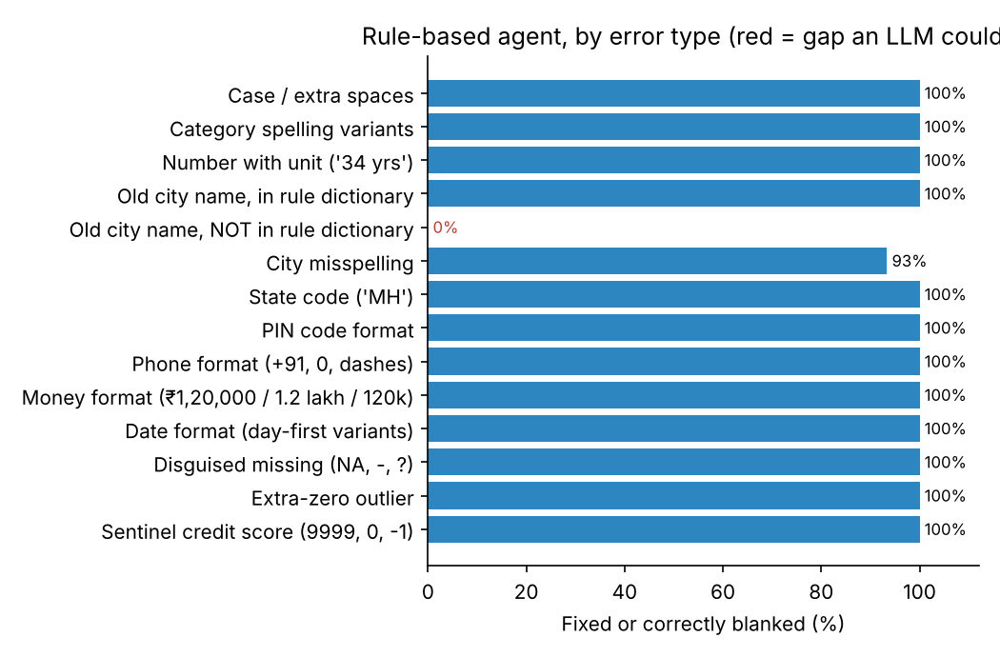
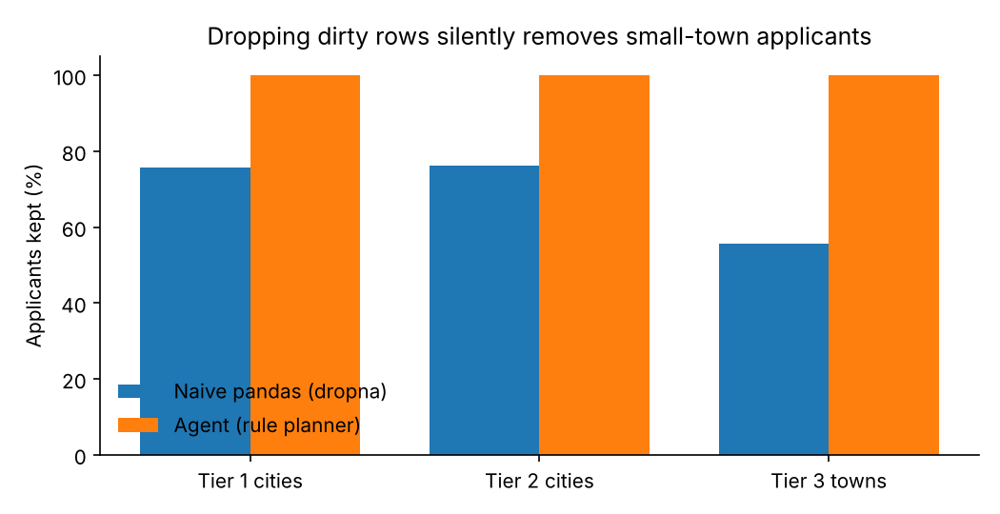
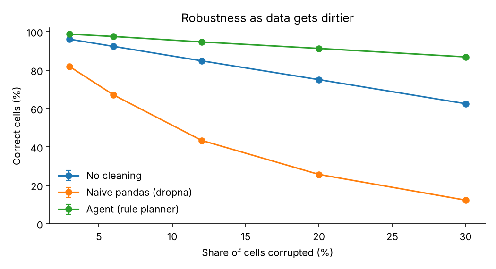

# CleanAgent: an AI agent for cleaning messy Indian data

Real Indian datasets are messy in specific ways: `₹1,20,000`, `1.2 lakh` and `120k` in one column, `05/03/2024`
meaning 5 March, `Bombay` next to `Mumbai`, `MH` next to `Maharashtra`, phones as `+91 98765 43210` or `098765-43210`,
and `NA`, `-` or `not available` standing in for blanks. CleanAgent finds and fixes these with an
**observe → plan → act → verify** loop, logs every change it makes, and refuses steps that would destroy data.

Idea **#96 (AI agent for data cleaning)** from *100 Innovation Project Ideas* (Dr. M. M. Kazi), Advanced level.

## How the agent works

```
   ┌──────────── observe: profile every column, infer its type, list issues
   │                │
   │             plan: Rule planner | LLM planner | Hybrid (rules + LLM for what rules can't match)
   │                │
   │             act: ONLY whitelisted tools (12 of them). The LLM can never run its own code.
   │                │
   │             verify: guardrails reject steps that drop >15% of rows, blank >25% of a column
   │                │    or rewrite >50% of a column; every applied change is logged with a reason
   └──── repeat ────┘  (until no issues are left or 4 iterations)
```

| Handout rule | What this project does |
|---|---|
| Scope it | One problem, one benchmark dataset (5 seeds), six methods compared, plus an ablation |
| Deploy it | Streamlit app (upload a CSV, watch the agent's trace, download cleaned data and a report) and a CLI |
| Explain it | Full audit trail: every changed cell with before, after, tool and reason; Markdown cleaning report |
| Localize it | Lakh/crore money, day-first dates, +91 phones, PIN codes, state codes, renamed Indian cities |
| Measure it | Ground-truth benchmark: cells fixed, clean cells damaged, rows kept, duplicates, downstream AUROC, and a fairness check |

## Run it

```bash
pip install -r requirements.txt
streamlit run app/streamlit_app.py            # interactive app
python -m cleanagent data/sample_messy.csv    # clean any CSV from the command line
python -m cleanagent.benchmark                # full benchmark (about 5 minutes), writes reports/
pytest -q tests                               # 17 tests
```

**Using an LLM (free, on your own laptop).** Start a local server in LM Studio (Developer tab → Start server) or
Ollama, then:

```bash
export CLEANAGENT_LLM_BASE_URL=http://localhost:1234/v1     # Ollama: http://localhost:11434/v1
export CLEANAGENT_LLM_MODEL=<model name shown by the server>
python -m cleanagent data/sample_messy.csv --mode hybrid
python -m cleanagent.benchmark --llm                        # writes reports/RESULTS_llm.md
```

Any OpenAI-compatible API works (set `CLEANAGENT_LLM_API_KEY` for hosted ones). In the app, pick the planner in the sidebar.

## The benchmark

There is no public dataset of messy Indian records with known correct values, so the benchmark builds one:

1. Generate 3,000 clean loan applications (names, cities, states, PINs, phones, incomes, loan amounts,
   credit scores, dates) with a default label.
2. Corrupt 6% of cells with 14 realistic error types and add 3% near-duplicate rows, **recording every change**.
3. Clean with each method and compare against the recorded truth.

Some old city names (`Poona`, `Cochin`, `Trivandrum`, `Vizag`, `Banaras`, ...) are deliberately **left out of the
rule dictionary**, to measure what rules miss and an LLM could add. Applications from tier-3 towns get twice the
error rate (more paper forms), to check whether cleaning treats them worse.

**Faulty planner** = the rule planner plus four wrong but plausible steps per run (parse a money column as dates,
drop "duplicates" by city, set ages outside 25-55 to blank, map many cities to "Mumbai"...). It stands in for an
LLM that misreads the data, and tests whether the guardrails contain the damage.

## Results (mean ± std over 5 datasets)

### Main comparison (3000 applications, 6% cell error rate, 3% near-duplicates; mean ± std over 5 datasets)

| Method | Correct cells (all applicants) | Fixable errors fixed | Bad values blanked | Clean cells damaged | Applicants kept | Duplicates resolved | Downstream AUROC |
|---|---|---|---|---|---|---|---|
| No cleaning | 92.3% ± 0.2 | 0.0% ± 0.0 | 34.7% ± 2.1 | 0.0% ± 0.0 | 100.0% ± 0.0 | 0.0% ± 0.0 | 0.808 ± 0.005 |
| Naive pandas (dropna) | 66.8% ± 0.9 | 0.0% ± 0.0 | 0.0% ± 0.0 | 0.0% ± 0.0 | 70.4% ± 0.9 | 1.1% ± 0.7 | 0.800 ± 0.004 |
| Agent, single pass | 97.5% ± 0.1 | 99.1% ± 0.2 | 77.2% ± 1.0 | 0.0% ± 0.0 | 100.0% ± 0.0 | 100.0% ± 0.0 | 0.806 ± 0.005 |
| Agent (rule planner) | 97.5% ± 0.1 | 99.1% ± 0.2 | 100.0% ± 0.0 | 0.0% ± 0.0 | 100.0% ± 0.0 | 100.0% ± 0.0 | 0.808 ± 0.005 |
| Faulty planner + guardrails | 96.7% ± 0.8 | 98.7% ± 0.5 | 100.0% ± 0.0 | 0.9% ± 0.8 | 100.0% ± 0.0 | 100.0% ± 0.0 | 0.800 ± 0.008 |
| Faulty planner, no guardrails | 49.6% ± 40.4 | 82.6% ± 7.2 | 100.0% ± 0.0 | 15.0% ± 2.1 | 60.1% ± 48.9 | 60.2% ± 48.7 | 0.775 ± 0.003 |

AUROC of the same model trained on the original clean data: 0.807 ± 0.008.

### Errors fixed by type: Agent (rule planner)

| Error type | Fixed or correctly blanked |
|---|---|
| Case / extra spaces | 100.0% ± 0.0 |
| Category spelling variants | 100.0% ± 0.0 |
| Number with unit ('34 yrs') | 100.0% ± 0.0 |
| Old city name, in rule dictionary | 100.0% ± 0.0 |
| Old city name, NOT in rule dictionary | 0.0% ± 0.0 |
| City misspelling | 93.4% ± 3.7 |
| State code ('MH') | 100.0% ± 0.0 |
| PIN code format | 100.0% ± 0.0 |
| Phone format (+91, 0, dashes) | 100.0% ± 0.0 |
| Money format (₹1,20,000 / 1.2 lakh / 120k) | 100.0% ± 0.0 |
| Date format (day-first variants) | 100.0% ± 0.0 |
| Disguised missing (NA, -, ?) | 100.0% ± 0.0 |
| Extra-zero outlier | 100.0% ± 0.0 |
| Sentinel credit score (9999, 0, -1) | 100.0% ± 0.0 |

### Fairness: who loses data? (tier-3 towns have 2x the error rate in this simulation)

| Method | Kept: tier 1 | Kept: tier 2 | Kept: tier 3 | Fixed: tier 1 | Fixed: tier 3 |
|---|---|---|---|---|---|
| No cleaning | 100.0% ± 0.0 | 100.0% ± 0.0 | 100.0% ± 0.0 | 0.0% ± 0.0 | 0.0% ± 0.0 |
| Naive pandas (dropna) | 75.7% ± 0.6 | 76.1% ± 1.5 | 55.6% ± 1.7 | 0.0% ± 0.0 | 0.0% ± 0.0 |
| Agent, single pass | 100.0% ± 0.0 | 100.0% ± 0.0 | 100.0% ± 0.0 | 99.5% ± 0.2 | 98.9% ± 0.3 |
| Agent (rule planner) | 100.0% ± 0.0 | 100.0% ± 0.0 | 100.0% ± 0.0 | 99.5% ± 0.2 | 98.9% ± 0.3 |

### Error-rate sweep (3 datasets per rate)

| Error rate | No cleaning: correct cells | Naive pandas (dropna): correct cells | Agent (rule planner): correct cells | Naive: applicants kept |
|---|---|---|---|---|
| 3% | 96.1% ± 0.0 | 81.9% ± 0.2 | 98.8% ± 0.0 | 84.0% ± 0.1 |
| 6% | 92.4% ± 0.0 | 67.1% ± 0.1 | 97.5% ± 0.1 | 70.6% ± 0.1 |
| 12% | 84.9% ± 0.2 | 43.4% ± 0.7 | 94.7% ± 0.1 | 48.0% ± 0.9 |
| 20% | 75.1% ± 0.1 | 25.7% ± 0.5 | 91.3% ± 0.1 | 30.5% ± 0.6 |
| 30% | 62.5% ± 0.2 | 12.3% ± 0.3 | 86.9% ± 0.0 | 15.8% ± 0.3 |

| Seconds per run | No cleaning: 0.0 | Naive pandas (dropna): 0.0 | Agent, single pass: 1.6 | Agent (rule planner): 2.1 | Faulty planner + guardrails: 2.3 | Faulty planner, no guardrails: 1.6 |







### What the numbers say

- **The agent recovers almost everything fixable.** 99.1% of fixable errors are restored to the exact true value
  without damaging a single clean cell, and every bad value it can't fix (outliers, sentinels, placeholders) is
  blanked rather than left in. Correct cells go from 92.3% (no cleaning) to 97.5%; the rest are values that were
  destroyed and cannot be recovered by anyone.
- **The usual notebook approach is the worst option.** `dropna()` keeps only 70% of applicants and ends at 66.8%
  correct cells, worse than not cleaning at all. At 20% dirty cells it keeps under a third of the data.
- **Re-observing matters.** A single pass fixes formats but cannot range-check numbers that were still text, so it
  blanks only 77% of bad values, against 100% for the full loop.
- **Rules have a hard ceiling.** Old city names that are not in the dictionary are fixed **0%** of the time, and
  2-7% of misspellings are missed. This is the gap the hybrid LLM mode is designed for.
- **Guardrails are essential for any LLM-driven agent.** With the faulty planner, guardrails keep damage to 0.9% of
  clean cells. Without them, 15% of clean cells are damaged, and in 2 of 5 runs a bogus de-duplication deleted
  almost the entire table (hence the ±40% spread).
- **Fairness.** `dropna()` keeps 76% of applicants from big cities but only 56% from tier-3 towns, so a model built
  on that data silently under-represents small towns. The agent keeps everyone and fixes errors equally well in
  every tier (99.5% vs 98.9%).
- **Downstream AUROC barely moves (0.800-0.808), and the README says so.** The gradient-boosting model tolerates
  missing values, so at 6% errors cleaning changes data quality much more than this one model's score. The real
  costs here are lost applicants and the bias above, not AUROC.

### Limitations

- The benchmark data is synthetic, and the agent's rules were written knowing the error types, so 99-100% scores
  on known types are an upper bound. Unknown aliases and misspellings are the honest test.
- LLM results are not in this README: they need a local or hosted model. Run `python -m cleanagent.benchmark --llm`
  to fill `reports/RESULTS_llm.md` with your model.
- Day-first dates are assumed (Indian convention). A US-format file needs `dayfirst=False`.
- The guardrail thresholds are judgement calls; one faulty step (an age range of 25-55) slips under them.

## Layout

```
cleanagent/  profiler.py   observe: column types and issues
             planner.py    plan: rule, LLM and hybrid planners, step validation
             tools.py      act: the 12 whitelisted tools
             agent.py      the loop and guardrails
             parsers.py    Indian money, dates, phones, PINs   categories.py  variant/alias/typo matching
             llm.py        OpenAI-compatible client            report.py      audit report
             data.py       benchmark generator and corrupter   score.py       metrics
             baselines.py  naive pandas, single pass, faulty planner
             benchmark.py  all experiments
app/         streamlit_app.py
tests/       test_cleanagent.py
data/        sample_messy.csv
reports/     RESULTS.md results.json *.png
```
